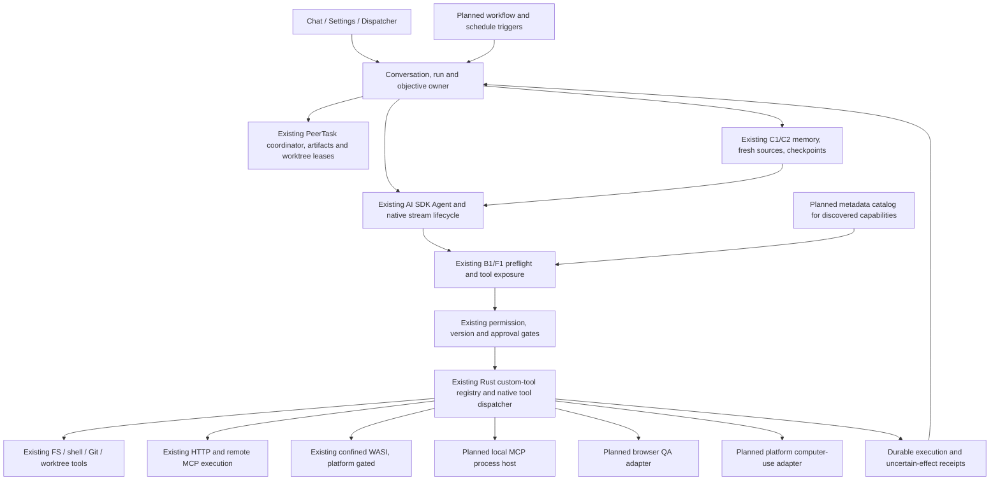

# Chat On Steroids Full-Platform Audit and Clack Capability Roadmap

Status: P0 source audit and implementation plan complete, 2026-10-22. No application implementation authorized by this document.

## Evidence, authority, and scope

- **Clack baseline:** `0ace76822ea02f71204dfba8a1fd4796811e661d`, `main`, with six pre-existing modified acceptance files, an empty index, and two safety stashes. See `AGENT_ENGINEERING_STATE.md` for the checkpoint exchange protocol.
- **Public Chat On Steroids (CoS) snapshot:** [`f50a8d30c1903193a9346f155431b4c57e730955`](https://github.com/totec448-spec/chat-on-steroids/tree/f50a8d30c1903193a9346f155431b4c57e730955), dated 2026-10-21. Its MIT license applies to the upstream code; Clack remains Apache-2.0. The source was cloned only into ignored `src-tauri/target/p0-cos-audit`. No upstream runtime was installed or run.
- **Audit surface:** Electron `src/main`, `src/shared`, `src/preload`, `src/renderer`, browser `extension`, native helpers, plugin catalog/runtime, skills, public docs, tests, packaging and CI. This is a capability-level inventory of the publicly available project, not a claim that every source line, upstream deployment, or live service was exercised.
- **Proof levels:** `S` means inspected source and contract; `T` means associated source tests exist, not rerun here; `C` means Clack has separately documented controlled/automated acceptance; `L` means real live-provider/hardware acceptance. A source declaration or historical test cannot establish current live readiness. This audit is `S`, with selectively inspected `T` and prior Clack `C`, and no new `L`.
- **Evidence precedence:** current user objective, current Clack source and tested behavior, current pinned CoS source/tests, then contemporary docs. The older Clack [`COS_COMPARATIVE_AUDIT.md`](COS_COMPARATIVE_AUDIT.md) remains a focused historical comparison. CoS's extensive [`AGENTS.md`](https://github.com/totec448-spec/chat-on-steroids/blob/f50a8d30c1903193a9346f155431b4c57e730955/AGENTS.md) documents intended behavior and known gaps, but individual source owners and tests decide implementation status.
- **Classification:** **I** implemented in Clack with relevant source (not universal production acceptance); **P** partially implemented or differently bounded; **M** missing; **N** better achieved through Clack's existing native design rather than copying CoS internals. `I/N` means the capability is already stronger or more naturally owned by Clack. Decision verbs: **retain**, **adapt**, **improve**, **add**, **avoid**.

## Product objective and principles

Clack should be a complete, light, local-first Agentic IDE and automation platform: a user can choose a workspace and an accessible local/self-hosted or hosted model, ask for substantial work, grant scoped capabilities, see truthful progress, steer and delegate tasks, and receive a tested result with inspectable artifacts. Plugin discovery, browser and desktop operations, durable goals, repeatable workflows, and third-party integrations are part of the platform, not the definition of the platform.

The benchmark of value is useful completed work, especially with small local models. Automatic setup must be based on endpoint/model revision, advertised versus verified capabilities, exact working-context and output limits, native tool readiness, legal reasoning controls and measured results. Fail closed on identity, stale evidence and unknown side effects. Never silently route local requests to cloud, widen workspace permission, replay uncertain mutations or hide incomplete outcomes. Existing source-linked memory, PeerTask ownership, Tauri OS authority, provider transport, F1/B1 context preparation, approvals and immutable review/apply remain canonical.

## CoS architecture map

| Layer | Upstream source owners and actual role | Clack translation |
| --- | --- | --- |
| Model/UI bridge | `src/main/bridge.ts`, `extension/background.js`, `extension/content.js`, `extension/fiber.js`, `src/main/cos-browser/`: model runs in a ChatGPT browser session; extension observes and authors messages | **Avoid** browser automation as Clack's model transport. Clack already directly invokes providers through the AI SDK and Rust HTTP proxy. Only adopt receipt/identity lessons. |
| Durable chat identity | `src/main/session/store.ts`, `recorder.ts`, `correlation.ts`, `read-model.ts`: local session independent of replaceable provider frontend, recorded native turns and tool activity | **Adapt** durable evidence, turn identity and queue concepts into existing Clack session/run stores. Clack's provider conversation model differs. |
| Tool ingress and composition | `src/main/mcp/{server,surfaces,kernel,tools,code-mode-tool,code-mode-runtime}.ts`: Core, Desktop, Plugins surfaces with request identity and bounded code-mode composition | **N** Clack uses native SDK tool registration and Tauri commands; reuse custom-tool registry, F1 and guarded executions rather than copying a public MCP ingress as the primary Agent runtime. |
| Workers/goals | `src/main/agents.ts`, `goal.ts`, `session/{input,finish,continuation}.ts`: prime families, sleeping workers, durable Goal/Loop decisions, end-turn and browser handoff | **P/N** Clack already has durable PeerTasks, isolated worktrees and native run budgets. Add missing lifecycle/goal semantics at these owners. |
| Plugin hosting | `src/main/plugins/{catalog,installer,manager,exposure,oauth}.ts`: reviewed recipes, installed MCP servers, tool filtering and remote authorization | **P** Extend `conversation_memory/custom_tools` and Settings. Preserve Clack's native permission and sandbox boundaries. |
| Desktop capabilities | `src/main/computer`, `src/main/browser-control.ts`, `src/main/cos-browser`, `src/main/remote`, `src/main/project-*`, renderer docks and terminal | **P/N** Build browser/desktop tools around Tauri platform permissions; keep the real PTY, editor, source control and existing preview. |
| Human experience | `src/renderer/{chat,agent-panel,workspace-docks,plugins,skills,context-meter,usage,tool-result,sidebar-*}.ts` | **N** Clack's React Settings, Dispatcher, transcript, PTY dock, editor, preview and themes remain native owners; import only tested user journeys and missing controls. |
| App-to-app API | `src/main/control-api.ts`, `control-{reads,actions,workers,stream}.ts`: opt-in loopback status/events and bounded action endpoints | **M** Add only through explicit scoped Clack local API if workflows actually need it; do not expose existing internal IPC directly. |

CoS source intentionally distinguishes generated workflow checkpoints from the display-only `update_plan`, Goal from Loop, user input queued from model-accepted input, worker identity from a reused slot label, and session identity from a browser conversation id. These distinctions are valuable even when the implementation differs. See upstream `AGENTS.md` sections 1-4, 11, 14-18 and `docs/tool-surface.md`.

### Target Clack architecture, using current owners

The following is a **design target**. The workflow trigger, capability metadata index, local MCP process host, browser control and desktop adapter are future additions, not shipped claims.

Do not create a separate orchestrator for every new integration. The registration/index layer describes tools; the native dispatcher enforces actual permissions and effects at invocation; the session/runtime owner tracks overall objective, continuation, cancellation and evidence. Workflow and scheduled automation deliver instructions through these same paths and cannot silently bypass them.

## Full useful-capability inventory and Clack crosswalk

Each source path below is relative to the pinned CoS commit. Clack paths are repository-local at the stated baseline. `T` lists representative upstream test owners; it does not claim their current run status. Entries are grouped by user outcome, not upstream directories.

### A. Engineering workspace, source and project operations

| Capability and upstream evidence | Clack status and owner | Decision / remaining work |
| --- | --- | --- |
| Project/session binding, project catalog/colors/groups, chat pin/order, Inbox attention hierarchy. `main/projects.ts`, `main/chat-groups.ts`, `renderer/sidebar-*`, `test/projects*` (`S/T`) | **P/N** `modules/workspace`, `modules/tabs`, `ai/lib/sessions`, `DispatcherNavigator` | **Adapt** useful project grouping, attention-first navigation and pinning if requested. Keep workspace permission separate from grouping. |
| Safe file read/search/glob and patches, exact approved roots. `main/codex/{filesystem,apply-patch}`, `main/sandbox.ts`, `test/fsops*` (`S/T`) | **I/N** Rust `modules/fs`, AI file tools, `modules/explorer`, diff review | **Retain** Rust canonical-path/secret guards. Compare partial/atomic patch semantics as focused tests rather than wholesale port. |
| Visible file tree, code editor, Git diff/review, local file watchers. `main/project-files.ts`, `project-git.ts`, `project-file-watcher.ts`, `renderer/file-panel.ts` (`S/T`) | **I/P** CodeMirror editor, explorer, Git panels; live FS refresh is less complete | **Improve** bounded watcher invalidation, external-edit awareness and conflict UX using Clack's native FS owner. |
| Real terminal command execution, bounded output, persistent shell and window terminal. `main/codex/{shell,manager,exec-output,head-tail-buffer}`, `renderer/workspace-terminal.ts` (`S/T`) | **I/N** Rust `pty`, `shell`, frontend xterm + process/session tools | **Retain** superior PTY model. **Adapt** explicit head/tail omission notices and durable process custody where missing. |
| Git worktree allocation, exact worker ownership, safe cleanup review. `main/worktrees`, `main/agents.ts`, `test/worktree*` (`S/T`) | **I/P** `modules/git/agent_worktree.rs`, AI `workspaceWriteLease`, `peerReview`, `peerTaskCoordinator` | **Retain/improve** isolated review/apply and stale/dirty conflict fences; add explicit user cleanup/retained-worktree overview as needed. |
| SSH/SFTP-backed remote projects with root containment and opt-in operation routing. `main/remote/{ssh,sftp,project-fs}.ts`, `main/projects.ts`, `test/remote*` (`S/T`) | **P** `modules/remote_ssh` currently targets inference transport; local/WSL workspace exists | **Add** remote IDE file/terminal/project operations as a separate authorization scope. Do not confuse SSH inference tunnel with remote filesystem access. |
| Project `AGENTS.md` instruction injection and scope. `main/projects.ts`, `session/skill-prompt.ts` (`S/T`) | **P** Clack `CLACK.md`/`TERAX.md` project memory and custom instructions, project evidence ownership | **Adapt** bounded instruction provenance and freshness. Explicitly distinguish trusted Agent directives from untrusted workspace text. |
| Markdown/PDF/image viewing, rich diffs, export and copy. `renderer/file-*`, `main/session/markdown-export.ts`, `main/image-export.ts` (`S/T`) | **P/I** existing Markdown, image/PDF attachment inspection, diff tabs and clipboard | **Improve** searchable durable exports and visual artifact handoff, without extending preview into a full general browser. |

### B. Agent orchestration, intent, delegation and autonomous execution

| Capability and upstream evidence | Clack status and owner | Decision / remaining work |
| --- | --- | --- |
| Authored Goal objective independent of current last message, Goal can finish without another turn; Loop continues within the same brief. `main/goal.ts`, `shared/goal.ts`, `test/goal*` (`S/T`) | **P** `ai/lib/runBudget.ts`, todo and task lifecycle, `chatRuntime` | **Adapt** explicit durable objective and finish obligation at session owner. Preserve Stop/approval/hard ceilings, avoid endless self-prompts. |
| Decision helper versus task executor, selectable ChatGPT/API backends. `main/goal.ts`, `shared/goal-reasoning.ts`, `test/goal-backends*` (`S/T`) | **P/N** Clack runs configured models and delegated PeerTasks directly | **Adapt** optional *local* bounded verifier/planner only after evidence justifies extra inference; never secretly use cloud or claim model quality from helper success. |
| Automatic 2-12-stage generated workflow with stage-one complete brief and durable later checkpoints. `main/task-request.ts`, `session/input.ts`, `test/task-plan*` (`S/T`) | **P** todo plans and bounded run continuation | **Add** explicit user-visible verification checkpoints/queue; never treat todo status as an executed action or withhold the specification until a later stage. |
| Per-prime worker families, concurrent slots, sleeping/wake/reuse, staged message/finish, backpressure and bounded histories. `main/agents.ts`, `shared/worker-brief.ts`, `test/agents*` (`S/T`) | **P/I** `ai/lib/peerTaskCoordinator`, `peerTaskStore`, `peerCommunication*`, `peerTaskQueueBridge` | **Improve** retained reusable workers and exact lease lifecycle on existing PeerTask, not a second worker broker. Distinct agents/conversations already exist. |
| Parallel task dispatch, explicit assignment, result delivery, wait-for-my-workers. `main/agents.ts`, `main/bridge.ts`, `test/agents*` (`S/T`) | **I/P** dependency graph, bounded clarification, artifacts, concurrent edit isolation and Dispatcher | **Retain** Clack's stronger recipient model/review; add opt-in per-parent wait barrier and truthful aggregated completion where missing. |
| Assistant-facing `update_plan` bound to exact session, not execution. `main/mcp/plan-tool.ts`, `session/request-plans.ts` (`S/T`) | **I/P** `todo_write` and run status | **Adapt** stale-write prevention and display-only plan semantics. Validate source evidence separately. |
| Explicit finish hold for eligible model/turn, with pending work taking priority. `main/session/finish.ts`, `shared/finish.ts`, `test/session-finish*` (`S/T`) | **P** `runBudget`, `chatRuntime`, unfinished todos and response state | **Adapt** an end-of-run completion gate owned by the native session. Avoid provider-specific forced finish tool or timer coupling. |
| User correction during work, bounded after-turn queue, deduplicated send/ack receipts. `main/session/{input,start-input}.ts`, `main/bridge.ts`, `test/input-*` (`S/T`) | **P** composer, per-session pending input, approval/continuation | **Improve** exact correction ownership and future-input queue with durable receipt/idempotency on Clack's own provider dispatch. |
| Multiple prime families executing independently. `main/agents.ts`, `test/agents*` (`S/T`) | **I/P** per-session runtime/isolation with background runs and shared endpoint admission | **Retain** per-conversation Agent/model/workspace snapshot; add fair scheduling/visibility only where measured. |
| Stop/Block/Trust, exact caller attribution, permission revocation. `main/mcp/{kernel,call-context}.ts`, `main/session/{blocked-chats,trusted-chats}.ts` (`S/T`) | **I/N** Chat Only/Ask/Trusted Workspace/Full Access/Custom, scopes, native approval and cancellation | **Retain** existing stronger native ownership. Never map coarse CoS connector authorization onto Clack filesystem privilege. |

### C. Context, evidence, recovery and reliability

| Capability and upstream evidence | Clack status and owner | Decision / remaining work |
| --- | --- | --- |
| Durable session recordings, exact tool receipts, context-meter estimates and lifetime usage separated. `main/session/{recorder,read-model,usage}.ts`, `renderer/context-meter.ts` (`S/T`) | **I/N** source-linked `conversation_memory`, `contextBudget`, `chatActivity`, `checkpoint` | **Retain** original-source authority and provider wire estimates. CoS local token estimates are not portable provider context truth. |
| Compact & Resume from one ChatGPT browser conversation to another, with A/B provenance and outbox/worker history. `main/session/{continuation,handoff}.ts`, `test/continuation*` (`S/T`) | **P/N** same-session provider continuation, C1/C2, evidence retrieval and immutable session ID | **Adapt** explicit recovery/migration only when local session needs it; no browser-chat rebind mechanism or subscription-session bridge. |
| Protected intent, source-linked history, exact last unfinished response, no replay of side effects. `main/session/{handoff,continuation}.ts`, `shared/handoff.ts` (`S/T`) | **I/P** `conversationCompaction`, `writeCheckpoint`, `verifiedWriteHistory`, `answerContinuation` | **Improve** pending obligations, model continuation semantics and exact-write projection with real evidence; do not summarize away current partials. |
| Gap/idle/delivery repair, delayed browser observations and duplicate-action suppression. `main/bridge.ts`, `main/session/{resume-gate,input}.ts`, `extension/background.js` (`S/T`) | **P/N** D1/D2/D3 lifecycle, native interrupted-run recovery | **Adapt** principle of durable ownership/unknown effects; avoid browser-tab retry machinery since Clack owns provider transport. |
| Code-mode bounded JS tool composition with nested call accounting. `main/mcp/{code-mode-tool,code-mode-runtime,code-mode-worker}.ts`, `test/code-mode*` (`S/T`) | **M/P** guarded individual AI tools, WASI functions and SDK tool calls | **Adapt** limited batch/composition facility only with explicit permissions, budget, cancellation and output receipts. Prefer native deterministic orchestration/WASI rather than arbitrary hidden JS privilege. |
| Long command output with explicit truncated head/tail and retained logs. `main/codex/{exec-output,head-tail-buffer}.ts`, `test/exec-output*` (`S/T`) | **P** shell background logs and bounded ring buffers | **Improve** omission/provenance indicators and follow-up access without reinjecting bulky output into small contexts. |
| Model/account quota observations plus local Codex/Claude usage logs. `main/provider-usage.ts`, `session/usage.ts`, `renderer/usage.ts` (`S/T`) | **M/P** Clack own provider usage/budgets and status | **Adapt** optional provider-reported metrics where exposed; label measured vs estimated, never infer cloud quotas from local logs or rely on scraping accounts. |
| Transparent approval, failure, partial answer and tool-result activity timeline. `renderer/{tool-result,tool-approval,timeline-rounds}.ts`, `main/session/progress.ts` (`S/T`) | **I/P** `ChatControlSurface`, activity receipts, approvals and error cards | **Improve** per-round readability, folds for repetitive healthy status, and accurate evidence counts. |
| Explicit unknown side effects and no automatic replay. `main/session/input.ts`, `main/mcp/kernel.ts`, `main/plugins/manager.ts` (`S/T`) | **I/N** custom-tool receipts, PeerTask effect checks and D3 | **Retain** effect identity and reconciliation. This is non-negotiable for browser, databases and external APIs. |

### D. Tools, permissions, Skills and extensibility

| Capability and upstream evidence | Clack status and owner | Decision / remaining work |
| --- | --- | --- |
| Core MCP developer tools including read, find, patch, terminal, image, plan, workers and usage. `main/mcp/{tools-core,kernel}.ts`, `test/mcp-tool-declarations*` (`S/T`) | **I/N** Tauri `fs/git/shell/pty`, `ai/tools`, `runBudget` | **Retain** native tools; perform schema/behavior audit for omissions. Do not expose a duplicate user-facing Core connector. |
| Desktop MCP surface: browser tabs/snapshot/screenshot/navigate/action/evaluate/console/network, native windows/input/clipboard. `main/mcp/{tools-browser,tools-desktop,tools-desktop-windows,tools-desktop-macos}.ts`, `main/computer`, `test/computer*` (`S/T`) | **M/P** clipboard and preview exist, no full bounded browser/OS-control Agent tools | **Add** browser tools through an owned Playwright/Chromium session, computer control via explicit platform adapters; screenshots/media get typed artifacts. |
| Plugins MCP surface, enabled tool filtering, separate ingress identity. `main/mcp/tools-plugins.ts`, `main/plugins/{manager,exposure}.ts` (`S/T`) | **P/N** scoped Clack `custom_tools` in Rust, `customExecution.ts` and `toolExposure.ts` | **Adapt** install/activation/catalog, reuse native callable registry and versioned authorization rather than require ChatGPT app/connector enrollment. |
| Dynamic plugin management: pinned npm/Python recipes, explicit command, remote, MCPB bundle and reviewed GitHub recipe. `main/plugins/{catalog,installer,manager}.ts`, `shared/plugins.ts`, `test/plugins-*` (`S/T`) | **M/P** CustomToolsManager handles definitions and MCP remote connections, no managed installation system | **Add** staging, hash/manifest/notice validation, runtime availability, rollback/uninstall and lifecycle without automatic package installation on connect. |
| Remote MCP auth, OAuth, token custody, per-plugin reconnect/timeout. `main/plugins/{oauth,manager}.ts` (`S/T`) | **P** Rust `custom_tools/mcp.rs` HTTPS bearer credential and keyring references; no general OAuth authorization | **Adapt** OAuth callback/token rotation and endpoint trust with explicit user consent, per-call deadlines and cancellation without retrying uncertain mutations. |
| Huge plugin discovery and filtered schema publication. `main/plugins/exposure.ts` (`S/T`) | **P** Clack MCP discovery cap 16, F1 candidate cap 192, optional selection 16 | **Improve** paged manifest indexing, stable names and eligibility, no forced 16-tool hard failure. Only send narrowly relevant tool schemas to small local models. |
| Custom tool/script/function bindings, explicit approval and bounded execution. `main/codex`, `main/plugins/manager.ts` (`S/T`) | **P** Clack custom bindings are declarable broadly, but executors are narrower: native custom `read_file`, HTTP GET/POST, imported WASI and remote MCP are implemented; raw Script/Function and custom native `write_file/list_directory/create_directory` are unavailable | **Retain** fail-closed `execution.rs` support checks. Do not advertise declarable bindings as operational. Keep built-in native Agent tools distinct from custom-tool plugins. |
| Constrained code-mode composition: fresh isolated JS, bounded nesting, tool outputs and active caller identity. `main/mcp/{code-mode-runtime,code-mode-worker}.ts`, `test/code-mode*` (`S/T`) | **M/P** Clack supports individual tools and confined WASI but lacks general safe multi-tool composition | **Adapt** value through explicit composable native operations/optionally WASI. A convenience orchestration surface must never multiply permissions or hide effects. |
| Skills library from managed/user/project, Codex/Claude caches, bounded index, slash commands, exact or one implicit selection. `main/{skills,user-skills,skill-routing}.ts`, `shared/skill-routing.ts`, `renderer/{skills,skills-library}.ts`, `test/skills*` (`S/T`) | **P** Clack snippets/skills and slash commands in composer, but not equivalent multi-source package discovery/revision selection | **Adapt** discover skills as inert instructions/resources, explicit install/metadata, safe per-revision context preparation. Never treat a Skill manifest as an executable privilege. |
| Project instructions/AGENTS and safe read-only user skills. `main/session/skill-prompt.ts`, `main/user-skills.ts`, `test/user-skills*` (`S/T`) | **P** Clack `CLACK.md`/`TERAX.md` compatibility and project evidence; tracked instruction setup currently references ignored TERAX | **Improve** tracked source-of-truth instructions and durable scoped knowledge, no global home-folder permission implied by discovery. |
| Optional restricted local control API and event stream. `main/{control-api,control-actions,control-reads,control-stream,control-workers}.ts`, `test/control-api*` (`S/T`) | **M** Tauri IPC only, no supported app-local external automation API | **Add later** authenticated loopback read/event/status API with separately enabled actions; no unguarded model/chat/OS mutation endpoints. |

### E. Automation, scheduling and external orchestration

| Capability and upstream evidence | Clack status and owner | Decision / remaining work |
| --- | --- | --- |
| Goal mode with durable completion debt and model-assisted decision to continue or finish. `main/goal.ts`, `main/bridge.ts`, `test/goal*` (`S/T`) | **P** run budgets, continuation, source-linked evidence, todo | **Adapt** end condition that checks required outcomes and in-flight workers; use deterministic evidence before optional model decision. |
| Loop mode sustaining deeper passes within a retained objective. `main/goal.ts`, `shared/goal.ts` (`S/T`) | **M/P** manual Continue and bounded automatic Agent steps | **Adapt carefully** opt-in, bounded iteration with explicit stop conditions, spend limits and no self-relaunch when blocked. |
| Generated task-plan checkpoints delivered at verified finish, editable outbox. `main/task-request.ts`, `session/input.ts`, `session/request-plans.ts` (`S/T`) | **P** Agent todo and visible PeerTask dispatch | **Add** durable workflow run/step record, dependencies, attempts, approvals, verified results and user editing. |
| Persistent assistant/worker jobs, messages and before/after-turn queue. `main/agents.ts`, `main/session/input.ts` (`S/T`) | **P** Clack PeerTasks, per-session background runtime, worktree leases | **Improve** reusable worker pool, scoped queue receipts and on-demand wake while preserving separate conversation identities. |
| Opt-in local API status, stream, send, stop, cancel and worker controls. `main/control-api.ts`, `control-actions.ts`, `control-workers.ts` (`S/T`) | **M** No equivalent supported external control API | **Add** after runtime/effect ownership is mature, with per-client capability tokens and revocation. |
| Independent scheduled/recurring jobs with RRULE/cron/condition-watches | **M** Clack has no first-class recurring/scheduled Agent job owner | **Add beyond CoS.** The inspected CoS source documents Goal/Loop, deferred checkpoints and retry timers, **not a general persistent calendar/condition scheduler**. Build this as a dedicated policy/trigger layer over the same durable workflow engine, with timezone/DST and missed-run semantics. |
| Browser lifecycle and account-oriented background wake/cleanup. `main/{bridge,browser-wake}.ts`, `main/cos-browser`, `extension/background.js` (`S/T`) | **N** Clack starts local model calls directly; no ChatGPT browser dependency | **Avoid** hidden ChatGPT tab reopening/session token automation. For its own browser-control sessions, adopt narrow lifecycle and pinned owner lessons. |
| CI, issue/PR triage and release automation. `.github/workflows/{pr-triage,waiting-prs,weekly-digest,release,codeql}.yml` (`S`) | **P/N** Clack Git integration, checks, packaging/CI configuration | **Adapt** opt-in GitHub workflow skills/tools through a verified integration and separately maintain repository CI. Do not transplant unrelated upstream bots. |

### F. UI, accessibility, operations and developer experience

| Capability and upstream evidence | Clack status and owner | Decision / remaining work |
| --- | --- | --- |
| Unified workspace chat with resizable right and bottom docks, worker drawer, persisted shell tabs. `renderer/{workspace-docks,workspace-terminal,agent-panel}.ts` (`S/T`) | **I/N** Clack React main workspace, editor/preview/terminal bottom dock, Agent/Dispatcher | **Retain** Clack's IDE-first layout; borrow contextual worker inspection and dock-state UX selectively. |
| Two sidebar organizational views, attention priority, unread status, pinned/reordered groups and keyboard cycling. `renderer/{sidebar-order,sidebar-pins,sidebar-completion,chat-cycle}.ts` (`S/T`) | **P** Clack sessions and Dispatcher navigation | **Adapt** attention-focused history and keyboard navigation after usability test, without duplicating Dispatcher state. |
| Chat input commands, slash Skills, file references, model/reasoning selectors and voice dictation. `renderer/{skills,chat-models}.ts`, `main/dictation.ts` (`S/T`) | **I/P** Clack composer, attachments, voice, model/effort controls and snippets | **Improve** exact Skill selection, multi-source catalog, help and input ownership. Keep Clack provider metadata instead of scraping ChatGPT account options. |
| Context meter, usage/expenditure estimates and honest source labels. `renderer/{context-meter,usage}.ts`, `main/provider-usage.ts` (`S/T`) | **P/I** Clack B1/context UX, runtime stats, activity evidence | **Improve** provenance and clarity: configured/loaded/verified/recent working context, output reserve, request costs and effect ledger. |
| Rich timeline rounds, collapsing repeated activity, errors/Stop/recovery/approvals, worker indicators. `renderer/{timeline-rounds,tool-result,tool-approval,agent-activity}.ts` (`S/T`) | **I/P** Clack chat activity, approval cards and Dispatcher | **Adapt** readable grouping, exact latest activity, missing/partial result visibility and assistive focus behavior. |
| Settings onboarding with screenshots, security controls, plugin health, accessible keyboard and narrow-size UI. `renderer/{settings,setup-guide,plugins}.ts`, `docs/setup.md`, `test/plugins-ui*` (`S/T`) | **P** Clack settings, server discovery, CustomToolsManager and chat tool controls | **Improve** task-based setup: local model + workspace + first successful native tool + optional plugin; no tunnel or separate ChatGPT connector required. |
| Local project remote SSH workflow. `main/remote`, `renderer/ssh-project-dialog.ts` (`S/T`) | **M/P** inference-only managed SSH plus workspace environments | **Add** separately gated remote editing and terminals, preserving SSH host trust and path authority. |
| Built-in Chromium/browser control and external Chrome/Edge/Brave/Firefox bridge. `main/cos-browser`, `main/browser.ts`, `extension/*` (`S/T`) | **M/P** preview iframe, no Agent browser-control runtime | **Adapt** only web application automation and inspection. **Avoid** ChatGPT tab/control plumbing in the product. |
| Desktop screens/windows/accessibility/input and platform grants. `main/computer`, `main/mcp/tools-desktop*`, `test/computer*` (`S/T`) | **M** Clack clipboard helper is not general computer use | **Add later** opt-in OS-specific helper, visible capture/consent, stale frame/ref protection, rate/output limits and screen privacy. |
| User-facing plugin states, per-tool toggles, OAuth, refresh and tool/capability disclosure. `renderer/plugins.ts`, `main/plugins` (`S/T`) | **P** custom tools and MCP Settings; no catalog/install/update experience | **Add** one unified Agent Capabilities manager with both built-ins and optional integrations but single canonical ownership per configuration. |
| Languages, theming, tray, native notification, updater, packaging and accessibility checks. `renderer/i18n.ts`, `locales`, `main/turn-notifications.ts`, `electron-builder.yml`, `.github/workflows` (`S/T`) | **P/I** Clack Tauri themes, updater scaffold, platform packaging, Agent notifications | **Adapt** accessibility/i18n and release QA. Retain lightweight Tauri implementation and native platform conventions. |
| Optional desktop animated pet/companion. `renderer/pet*`, `pets`, `test/pet*` (`S/T`) | **M** intentionally absent | **Avoid for Agent roadmap**: graphics/CPU/maintenance cost is unrelated to code or automation task outcomes. User can request separately as cosmetic extension. |

### CoS ecosystem and actual supported sources

The pinned reviewed catalog contains **seven** entries, not a large general marketplace. These are source recipes or remote endpoints. Their listed tool names are examples and actual available operations depend on successful discovery and the user's local setup/service authorization. Source: [`src/main/plugins/catalog.ts`](https://github.com/totec448-spec/chat-on-steroids/blob/f50a8d30c1903193a9346f155431b4c57e730955/src/main/plugins/catalog.ts) and [`docs/plugins.md`](https://github.com/totec448-spec/chat-on-steroids/blob/f50a8d30c1903193a9346f155431b4c57e730955/docs/plugins.md).

| Catalog recipe | Pinned upstream identity | Principal capability | Clack status / target |
| --- | --- | --- | --- |
| Blender MCP | Python `blender-mcp@1.9.1`, community Blender addon | Inspect and create scenes, Blender code, viewport | **M**, specialized P-level plugin after process hosting; addon readiness gate |
| Knowledge Memory | npm `@modelcontextprotocol/server-memory@2026.8.31` | Persistent local entities, relations and observations | **P** current Clack project evidence is not a general graph; add explicitly optional knowledge graph |
| Playwright Browser | npm `@playwright/mcp@0.0.80` | Navigate, snapshot, interact, screenshot, browser tabs | **M**, high-priority browser QA integration with rich artifacts |
| Web Fetch | Python `mcp-server-fetch@2026.8.18` | Bounded web request/content extraction | **M**, high-priority read-only network tool with SSRF/trust controls |
| HeyGen Video | OAuth remote `https://mcp.heygen.com/mcp/v1/` | Hosted video/avatar/speech services | **M**, optional remote OAuth catalog later; user account and cost required |
| Recraft Design | OAuth remote `https://mcp.recraft.ai/mcp` | Hosted vector/image/styling operations | **M**, optional remote OAuth catalog later; user account and cost required |
| Unity Editor | Python `mcpforunityserver@10.2.0`, Unity plugin | Editor objects/scenes/materials/tests/logs | **M**, specialized local integration after process-host sandbox and readiness |

Supported custom plugin sources are npm, Python, direct executable arguments, remote MCP (HTTPS or loopback HTTP), local MCPB bundles, and GitHub URLs resolving to reviewed recipes. Arbitrary GitHub repositories are **not** directly executable just by giving their URL. A local plugin process inherits the operating-system user's rights and is **not contained by the host app's approved-root list**. CoS restricts its own plugin surface in read-only mode, but that does not sandbox the server. Clack should expose that privilege truth in install review and isolate processes where technically supported.

CoS currently caps published enabled plugin tools at **256** and **250 KB** of schemas; it tolerates an upstream discovery catalog up to **2,048** tools or **8 MiB** before emergency rejection, letting users disable tools to fit. That is a *publication* contract, not efficient local-model prompt delivery. Clack currently caps remote MCP discovery at **16 tools** (`conversation_memory/custom_tools/mcp/protocol.rs`, `mcp.rs`) and F1 initially processes **192 candidate schemas** with **16 optional** picks (`ai/lib/toolExposure.ts`). A scalable broker should index a larger eligible metadata catalog, then send only relevant schemas per model step. It must maintain exact scoped identity and avoid sending thousands of descriptions to an 8K/16K local model.

CoS's durable plugin lifecycle includes per-plugin generation directories, pinned updates with rollback, explicit install/configure/revoke/uninstall, encrypted credentials, managed subprocess/remote clients, readiness states, disabled-tool enforcement, and a 1-1800 second per-call deadline (default 120). Plugin updates need a successful replacement connection before publication. Remote plugin OAuth is a separate user-facing flow. Its connector-refresh notices concern ChatGPT tool-registration cache, which Clack's direct Agent SDK path does not need.

The CoS local Skills system is separate from MCP plugins: Markdown `SKILL.md` packages, slash commands and bounded metadata from managed, repo, Codex, Claude and user Skill roots. Optional implicit selection is exact-name matching with at most one match and a pinned revision; it does not perform semantic discovery or authorize executable code. Clack should preserve that separation between **instructions**, **callable tools**, **connection credentials**, and **workflows**.

## Detailed adoption decisions

### Adopt or improve within existing Clack owners

1. **One durable objective and verified completion ledger.** Extend the session/run record to retain the original user goal, later corrections, outstanding obligations, acceptance criteria and the current evidence that each is met or blocked. Derive completion from current source/runtime/test evidence, not a todo tick, model paragraph or number of calls. CoS `goal.ts` and `session/finish.ts` provide useful exact-turn ownership patterns; Clack's `chatRuntime`, `runBudget`, `conversationMemory` and receipt records must remain authoritative. CoS still records Goal publication transaction gaps in its own `AGENTS.md` section 21, so do not repeat those races.
2. **Durable queue and receipts.** Reuse Clack session and PeerTask persistence to track `prepared`, `queued`, `dispatched`, `accepted`, `completed`, `unknown-effect`, `cancelled` for user corrections, task checkpoints and automation. CoS `session/input.ts` carefully distinguishes a queued row from a browser-accepted send. For Clack, the relevant acknowledgment is a captured SDK/native dispatch and a durable tool-result/turn observation. A timeout after a side effect is not permission to repeat it.
3. **Dependency-aware task completion.** Clack's `peerTaskDependencies`, `peerTaskCoordinator`, `peerTaskStore`, native worktree leases and Review/Apply already provide typed artifact transfer, guarded mutation and better per-conversation model ownership. Add an optional family-local barrier before a parent concludes or continues automatically if its own required child results are unsettled. No second broker, global idle poller or new transcript-mirroring authority.
4. **Model-efficient capability discovery.** Evolve `toolExposure.ts` and `toolObjective.ts` from selecting relevant schemas among a bounded in-memory candidate set to a versioned metadata index searchable by goal/capability, prior success and task state. Keep mandatory built-in coding tools and in-flight tool names pinned; per-call permission and revision revalidation continues in Rust. Fallback search is allowed only among eligible tools, never a way to resurrect revoked tools.
5. **Tool result representation.** Bounded stdout head/tail with explicit truncation; typed screenshots and downloadable artifacts; original large output recoverable by explicit source IDs; no unconditional prompt replay. Clack's C1/C2, verified-write receipts and fresh workspace reads have priority over CoS's approximate context heuristics.
6. **A single Agent Capabilities manager.** Canonical Settings owns installed integrations, credentials, model compatibility, consent, active tool assignments and health. Chat presents the current conversation's actual capability affordance, approvals and deep links. Use `CHAT_CONTROL_SURFACE.md` as UI ownership contract. Do not build an additional shadow registry for Plugins, Skills or Automation.
7. **Remote workspace and real browser QA.** SSH inference tunnels are already a separate Clack native transport with host identity and leases. Remote project FS/SFTP, browser automation and desktop control require their own scoped permission sets. Native workspaces, session/Agent bindings and read/write guards remain the source of truth.

### Adapt cautiously and only with measured justification

- **Code mode:** CoS runs nested tools inside an isolated QuickJS/WASM worker: `code-mode-runtime.ts`, `code-mode-worker.ts`; limits include 64,000 source characters, 32 MiB JS memory, 2 seconds active CPU, 60 seconds wall, 32 child calls, eight concurrent calls and 40 KB emitted text. Nested effects survive a script timeout, so ledger and source identity remain mandatory. Clack may offer a small typed multi-tool batch/functional composition before adding JS. Test model calls and context saved against added overhead and security risk.
- **Goal/Loop assistants:** CoS can use a separate decision backend or ChatGPT helper, but its helper decisions are not verified evidence. Clack should first implement deterministic outstanding-obligation checks and an explicit bounded optional local reviewer, if the selected model supports the required structure and capacity. Reusing a cloud helper without explicit route consent would violate local-first ownership.
- **Skills auto-selection:** CoS's literal-name routing (`shared/skill-routing.ts`) intentionally abstains on ambiguity. Preserve this safe baseline, then evaluate user-approved semantic search with revocable index versions. Automatic description matching must not silently add files or executable permissions.
- **External API and scheduling:** A local event/status API can help automation, but it should call existing Clack authorities. A general calendar/condition scheduler needs new durable trigger semantics (timezone, DST, missed runs, shutdown, overlapping jobs, quotas, idempotency) and belongs **after** the workflow/effect ledger. It is an extension of the CoS vision rather than an already-complete CoS feature.
- **Computer use:** Browser automation, visible desktop window selection, screenshot provenance and cursor/keyboard control have different safety profiles. Keep them distinct, opt-in and platform-validated. A screenshot's screen location and its associated selection/geometry revision must be verified at action time.

### Deliberately avoid

- Automating ChatGPT's private browser DOM, account session, connector refresh or temporary chats as Clack's model inference runtime. CoS's bridge/extension model exists because its executor is ChatGPT's web interface. Clack already has direct AI SDK model transports, secure Rust proxy and local model support; it should not depend on browser scraping, tunneling its core tools into another model product, or copying provider login sessions.
- A second Clack Agent broker, context store, tool registry, secret store or permission system. New capabilities are projections/entries in existing canonical systems or clearly scoped new policy adapters.
- Prompting an Agent with hundreds or thousands of full tool schemas; making model-name branches for compatibility; equating tool-list discovery with model-ready native calls; accepting textual pseudo-tool markup as execution.
- Treating CoS's external subprocesses as sandboxed because the host has a root allowlist. External programs have their own OS privileges. Native sandbox and package trust must be established separately.
- Relaxing run limits, auto-retrying uncertain mutations, guessing remote trust identity, silently falling back to a cloud model, implicitly sharing another session's private context, or declaring complete because a helper said so.
- Porting CoS's decorative pet, Electron/browser-tab lifecycle, account quota scraping and provider-specific `session_finish` as mandatory product plumbing. Their engineering cost does not advance Clack's core Agent/IDE reliability.

## Local and self-hosted models: first-class capability contract

The model experience should require no knowledge of native protocol dialects. A user chooses a named connection and a discovered model, sees a truthful status, and starts working with Automatic settings when justified. A capable model cannot be classified as bad because Clack rejects a valid tool representation; a successful provider call is not evidence that the Agent can use tools correctly.

| Requirement | Canonical Clack owner | Minimum acceptance gate |
| --- | --- | --- |
| Provider endpoint, auth, SSH trust and remote transport | `selfHostedProfiles`, `selfHostedProbe`, `remote_ssh`, `net` | Exact endpoint/profile/revision, auth and loaded context, trusted remote identity; recovery fails closed after change |
| Inventory/metadata normalization and recommendations | `modelOnboarding`, `providerModelEvidence`, `selfHostedCapabilities`, `reasoningEffort` | Distinct advertised/configured/loaded/verified settings and legal reasoning controls; invalid or changed revision becomes stale |
| Native structured tool readiness | `toolVerificationRuntime`, `agent`, `requestPreflight` | Real bounded tool call path verified for the exact route and reasoning/output configuration, without executing textual pseudo-tools |
| Optional tool discovery and schema budget | `toolExposure`, `toolObjective`, Rust custom-tool registry | Relevant built-ins and required continuation tools never disappear; large external catalogs indexed without huge model context |
| Compact long work without losing obligations | `conversationCompaction`, native `checkpoint`, `verifiedWriteHistory`, retrieval | Exact user corrections and current partial preserved; real eligible source snapshots verified before provider reduction |
| Reliable continuation and end-of-task proof | `answerContinuation`, `runBudget`, `chatRuntime`, future obligation ledger | No false finish, effect replay or unbounded retry; distinguish model/runtime/provider/harness failures on preserved wire evidence |
| Local-only privacy, bounded resources and user control | permissions, keyring, admission, cancellation, source ownership | Zero unapproved cloud calls, exact workspace/Agent scope, meaningful Stop/approval and output/token/latency budgets |
| Easy application development workflow | existing editor/terminal/preview/PeerTask plus browser QA | From plain-language task to running app, independent tests, browser inspection and current source state; separate test defects from missing runtime |

Recommended evaluation sequence: offline deterministic fixtures first; captured provider-wire verification second; then an explicitly authorized live model run on fixed frozen workspace/engine/model/settings, with independent product tests and identical acceptance criteria. Record first native call latency, valid/invalid tool frames, retries, context and output reserves, external effects, completion obligations, wall time and real delivered functionality. Compare models only within the same task/environment/configuration; report uncertainty and zero-evidence outcomes rather than inventing a ranking.

In the latest committed Nemotron case (`0ace768`, `docs/REAL_LOCAL_MODEL_ACCEPTANCE.md`), nine native tools succeeded, two writes were observed, but three textual drafts followed, 19 API checks were blocked for missing application implementation, and the 120-second answer-continuation deadline ended the run. There was no checkpoint projection: zero eligible overwritten writes and no real context pressure. This means the next **diagnostic** step is to audit the native-tool-to-textual-draft transition with frozen evidence, not to raise deadlines or claim checkpointing already improved autonomy.

## Engineering sequence, dependencies and exit gates

This is the **complete capability roadmap**, not an authorization to implement it en bloc. Each checkpoint is a bounded change with source/test inventory, invariant, explicit ownership, rollback and independent verification. Earlier Clack multi-agent phases 0-7 and self-hosted A1-Z remain historical completed implementation programs and are not restarted. R and P tracks can be scheduled separately, but one code-writing checkpoint owns a shared worktree at a time.

| Checkpoint | Deliverable | Dependency and concrete exit gate |
| --- | --- | --- |
| **P0** | Whole-CoS source inventory, gap matrix, Clack-native architecture and durable roadmap | **This document** plus project handoff index, pinned source, preservation checks; no application code |
| **R1** | Native-to-textual tool transition audit | Frozen Nemotron/Qwen request/response/parser/continuation trace; classify exact source boundary with no new model calls or policy change |
| **R2** | Narrow runtime compatibility correction, only if defect proven | Independent regression using legitimate native calls, no parsing pseudo-tools or model-specific exception; ordinary checks and effect preservation |
| **R3** | Obligation/finish semantics | Exact intent, correction and outstanding requirements persist per session; completed/blocked determinations require receipts, source freshness and task-specific tests |
| **R4** | Checkpoint/continuation benefit validation | Natural eligible writes, a real projected provider payload, before/after byte and token evidence, identical restored originals and further productive work |
| **R5** | Local model productivity acceptance | Authorized fixed tasks across model/context bands, independent app tests, classification of model versus Clack defects; local-only proof |
| **P1** | Capability contract and registry extension | Versioned tool metadata/index and narrow provider exposure reuse existing Rust approval and `toolExposure`; no duplicate registry; cross-session revocation tests |
| **P2** | Scalable tool lookup for small contexts | Remote MCP discovery over 16 and searchable larger catalog, schema byte/token limits, pinned required tools, small-model native invocation fixtures |
| **P3** | Durable objectives, corrections and workflow queue | Build on R3 and existing `chatRuntime`/PeerTask, distinguish queued/dispatched/accepted/completed/unknown; restart/duplicate-send tests |
| **P4** | Family-local wait, reusable workers and review ergonomics | Dependency-aware worker outcome barrier, deliberate reuse, exact worktree/effect ownership and cancellation; no second broker |
| **P5** | Remote MCP lifecycle and auth expansion | Existing HTTPS client + OAuth PKCE/token refresh/credential scopes, per-call timeout/reconnect, schema/result semantics, revocation and no effect replay |
| **P6** | Local stdio host and plugin installation | Reviewed pins/manifest/isolated generations, explicit execution privilege, staged update/rollback, subprocess cleanup, data retention, hostile bundle/path tests |
| **P7** | Safe composite tool workflow | Measure native batch versus code mode; if useful, isolated interpreter with child ACL, total context/operation cost, nested receipt and cancellation guarantees |
| **P8** | Browser QA capability | Playwright/Chromium adapter, snapshots, interactions, screenshots, console/network, page identity/cancel, test app end to end with real artifacts |
| **P9** | Web Fetch and persistent graph memory | SSRF-safe bounded read, citations and rich outputs; opt-in graph store distinct from private project evidence, provenance/freshness and deletion controls |
| **P10** | Unified capability/Skills/plugin UX | Discover, inspect, permission, connect, test, install, update, enable, revoke, remove; managed/user/project Skill revisions and truthful status |
| **P11** | Remote engineering projects | SSH project identity, SFTP/terminal/file/Git boundaries, workspace roots and portability; separate from model transport lease |
| **P12** | Persistent local automation engine | Workflow DAG/checkpoint state, exact user approval, wait/pause/resume, failure/unknown effect and durable execution receipts |
| **P13** | Scheduling and conditional watches | Recurrence/timezone/DST, missed-run handling, priorities/concurrency, quotas, quiet notifications, cancel/disable/recover; never launch while unavailable/unauthorized |
| **P14** | GitHub and repository workflows | Repo/issue/PR/CI access through scopes, draft/update/commit/review, idempotent external effects, exact evidence and user checkpoints |
| **P15** | Native computer control | Windows/macOS/Linux platform-specific permissions, capture/input/window identity, stale-frame rejection, accessibility and native GUI tests |
| **P16** | Specialist integration catalog | Blender/Unity plus design/video and general database/devops integrations as demand and secure host capabilities justify; cost/terms disclosure |
| **P17** | Agent quality and task orchestration UX | Goal/Loop bounded reviewer, multi-stage workflows, timeline/worker activity, mobile/narrow-pane accessibility, multi-source Skills, i18n |
| **P18** | Real platform/hardware qualification | Native Windows/Linux/macOS, GUI, WSL, Arch/Wayland, packaging, auth and local CPU/GPU server acceptance, no silent capability promotion |
| **P19** | Release and extension ecosystem operations | Version/sign/update/uninstall trust, licenses/notices, diagnostics, docs, recovery, performance regression and opt-in community catalog policy |

**Ordering gates:** R1 should precede any inference-policy edit. R3 should precede P3/P12 and automated finish decisions. P1/P2 should precede large plugin catalogs; P5 should precede OAuth catalog entries; P6 precedes Playwright/Blender/Unity process-backed distribution; P8 and P9 provide the first broad end-to-end Agent productivity evidence. P12 precedes P13. GUI/platform release claims require P18. Stages may be subdivided when one patch grows beyond independently verifiable scope.

### Bounded next engineering checkpoint

**R1: audit the native-tool-to-textual-draft transition** using already frozen traces, the current Clack source and provider adapter behavior. Its deliverables are a chronological wire/parser/SDK/continuation causal map, a model/engine/Clack/harness failure classification, the smallest reproducible non-mutating test if possible, and a clear change/no-change recommendation. No model benchmarks, downloads, deadlines, fallback, provider setting edits or broad new UX are implied. P1 capability-index work follows when that diagnostic boundary is understood. If R1 finds no Clack defect, document that result and advance without manufacturing a fix.

### Checkpoint contract and durable collaboration

1. On intake: read `CLACK.md`, this audit, `AGENT_ENGINEERING_STATE.md`, the relevant existing implementation/acceptance ledger, the current code, `AGENTS.md` and applicable legacy guidance. Record exact HEAD, status, stashes and protected hashes before touching anything.
2. Before implementation: name the checkpoint, owner files, existing Rust/React/session authority, baseline tests, exit criteria, rollback and evidence level. Do not treat a doc's old `Next` pointer as newer than code.
3. During work: one author per file/worktree, protect unrelated dirty/stashed work, create only authorized source changes and relevant tests. Keep user intent and revisions as durable evidence independent of model-generated descriptions.
4. After successful checkpoint: update only this roadmap's status and affected canonical docs plus `AGENT_ENGINEERING_STATE.md`, record source/fixture/test paths, exact passes/failures and limitations, and link the commit. Do not rewrite historical acceptance ledgers as if their older observations were new.
5. On handoff: the receiving agent independently compares committed HEAD, status, content hashes, recorded outcome and current code, then resumes the next bounded checkpoint. Pushing, release and model benchmarks remain separately authorized.

## Known uncertainty and audit limitations

- This P0 is source analysis. Upstream CoS feature existence was determined by inspecting the pinned code, declarations, tests and documentation. Upstream unit, browser, integration, packaged or live account tests were not executed here; presence of a test is not its passing result.
- Seven reviewed plugins are recipes, not seven verified live connections. Catalog example tool names are not current live discovery; hosted offerings, service costs and upstream distribution availability were not checked by starting providers.
- CoS `AGENTS.md` records known Goal durability/cross-ledger gaps. Its documented runtime intent cannot be assumed to fix those gaps. Clack prior Windows controlled acceptance likewise does not certify GUI or Linux/macOS native behavior.
- Clack's custom tool **definition** schema allows more kinds than the actual **executor** supports. Native `read_file`, HTTP GET/POST, imported WASI and registered remote MCP have guarded execution support; Script/Function and additional native custom operations are not available through that path. WASI production support depends on platform capability evidence: Windows verified, Linux/macOS still unverified in the inspected source.
- The Clack `README.md`, `ROADMAP.md` and opening summary of `AI_SELF_HOSTED_INFERENCE_PLAN.md` reflect earlier September/July status. Later per-checkpoint ledger rows, October source and `REAL_LOCAL_MODEL_ACCEPTANCE.md` supersede those summaries. Historical evidence should be linked, not silently rewritten.
- The CoS plugin runtime is architecturally tied to separate ChatGPT MCP connectors and its browser extension. The relevant features should be judged on usefulness to Clack, not recreated mechanically.

## Pinned primary source reading map

- [CoS repository at exact revision](https://github.com/totec448-spec/chat-on-steroids/tree/f50a8d30c1903193a9346f155431b4c57e730955), [product/ownership map](https://github.com/totec448-spec/chat-on-steroids/blob/f50a8d30c1903193a9346f155431b4c57e730955/AGENTS.md), [tool declarations](https://github.com/totec448-spec/chat-on-steroids/blob/f50a8d30c1903193a9346f155431b4c57e730955/src/main/mcp/surfaces.ts), [tool contracts](https://github.com/totec448-spec/chat-on-steroids/blob/f50a8d30c1903193a9346f155431b4c57e730955/docs/tool-surface.md).
- [CoS worker broker](https://github.com/totec448-spec/chat-on-steroids/blob/f50a8d30c1903193a9346f155431b4c57e730955/src/main/agents.ts), [Goal/Loop](https://github.com/totec448-spec/chat-on-steroids/blob/f50a8d30c1903193a9346f155431b4c57e730955/src/main/goal.ts), [durable input](https://github.com/totec448-spec/chat-on-steroids/blob/f50a8d30c1903193a9346f155431b4c57e730955/src/main/session/input.ts), [session continuation](https://github.com/totec448-spec/chat-on-steroids/blob/f50a8d30c1903193a9346f155431b4c57e730955/src/main/session/continuation.ts), [code mode](https://github.com/totec448-spec/chat-on-steroids/blob/f50a8d30c1903193a9346f155431b4c57e730955/src/main/mcp/code-mode-runtime.ts).
- [CoS plugin catalog](https://github.com/totec448-spec/chat-on-steroids/blob/f50a8d30c1903193a9346f155431b4c57e730955/src/main/plugins/catalog.ts), [installer](https://github.com/totec448-spec/chat-on-steroids/blob/f50a8d30c1903193a9346f155431b4c57e730955/src/main/plugins/installer.ts), [manager](https://github.com/totec448-spec/chat-on-steroids/blob/f50a8d30c1903193a9346f155431b4c57e730955/src/main/plugins/manager.ts), [OAuth](https://github.com/totec448-spec/chat-on-steroids/blob/f50a8d30c1903193a9346f155431b4c57e730955/src/main/plugins/oauth.ts), [plugin guidance](https://github.com/totec448-spec/chat-on-steroids/blob/f50a8d30c1903193a9346f155431b4c57e730955/docs/plugins.md).
- [CoS browser bridge](https://github.com/totec448-spec/chat-on-steroids/blob/f50a8d30c1903193a9346f155431b4c57e730955/src/main/bridge.ts), [native control API](https://github.com/totec448-spec/chat-on-steroids/blob/f50a8d30c1903193a9346f155431b4c57e730955/src/main/control-api.ts), [Skills](https://github.com/totec448-spec/chat-on-steroids/blob/f50a8d30c1903193a9346f155431b4c57e730955/src/main/skills.ts), [remote SSH projects](https://github.com/totec448-spec/chat-on-steroids/blob/f50a8d30c1903193a9346f155431b4c57e730955/src/main/remote/project-fs.ts), [UI docks](https://github.com/totec448-spec/chat-on-steroids/blob/f50a8d30c1903193a9346f155431b4c57e730955/src/renderer/workspace-docks.ts).
- Clack canonical architecture and evidence: [`CLACK.md`](../CLACK.md), [`AI_MULTI_AGENT_BUILD_PLAN.md`](AI_MULTI_AGENT_BUILD_PLAN.md), [`AI_SELF_HOSTED_INFERENCE_PLAN.md`](AI_SELF_HOSTED_INFERENCE_PLAN.md), [`CHAT_CONTROL_SURFACE.md`](CHAT_CONTROL_SURFACE.md), [`FINAL_ACCEPTANCE.md`](FINAL_ACCEPTANCE.md), [`LOCAL_AGENT_USABILITY_ACCEPTANCE.md`](LOCAL_AGENT_USABILITY_ACCEPTANCE.md), [`REAL_LOCAL_MODEL_ACCEPTANCE.md`](REAL_LOCAL_MODEL_ACCEPTANCE.md).
